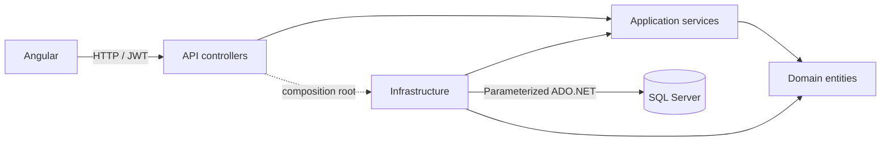

# TaskManager

[TaskManager Technical Assessment on GitHub](https://github.com/thiagosalles1988/TaskManager-Technical-Assessment)

A focused personal task manager built for a Senior .NET Developer assessment: a .NET 10 controller-based REST API, raw ADO.NET persistence on SQL Server, and a responsive standalone Angular application.

> As a registered user, I want to create, view, update, organize, and delete my personal tasks so that I can efficiently manage my daily responsibilities.

The application implements registration, login, JWT authentication, owner-isolated task CRUD, status changes, optional due dates, validation, responsive forms, loading/empty/error states, delete confirmation, development demo data, and automated verification. Product scope stays deliberately small.

## Quick start

Prerequisites: .NET 10 SDK, Node.js 24.15 or newer on the 24 LTS line with npm, and SQL Server (Express, Developer or an existing instance). Install SQLCMD for the creation command below, or create the empty database using your SQL administration tool. Docker is not required. Verification used .NET SDK 10.0.403, Node 24.18.0, npm 11.16.0 and SQL Server Express 2025 on Windows.

Clone the assessment, then run the setup commands **from the repository root**, where `TaskManager.slnx` is located. The default branch is `main`.

```powershell
git clone https://github.com/thiagosalles1988/TaskManager-Technical-Assessment.git
cd TaskManager-Technical-Assessment
```

```powershell
dotnet restore TaskManager.slnx
dotnet build TaskManager.slnx
sqlcmd -S '.\SQLEXPRESS' -E -C -b -i database/000-create-database.sql
.\scripts\Start-DevApi.ps1
```

The script generates a cryptographically random **process-only development signing key**, initializes the versioned schema and seeds demo data. It reuses `Jwt__SigningKey` if already set, including a key generated earlier in the same PowerShell session. A fresh shell without that variable generates a new key and invalidates old sessions; sign in again. It listens on `http://localhost:5100`. No key or SQL password is written into the repository. Stop it with Ctrl+C.

In a second terminal:

```powershell
cd taskmanager-web
npm ci
npm start
```

Open **http://127.0.0.1:4200**. Angular's development proxy forwards `/api` to port 5100, so no permissive CORS policy is needed. The development OpenAPI JSON is at http://localhost:5100/openapi/v1.json.

Development-only demo credentials:

| Email                    | Password                 |
| ------------------------ | ------------------------ |
| `demo@taskmanager.local` | `Demo-TaskManager-2026!` |

These are public, disposable assessment credentials, never production credentials. Seeding is opt-in and refused outside Development. It never resets the existing password or overwrites edited sample tasks. Stable sample IDs prevent duplication, including concurrent seeded starts; deleting a sample allows it to be recreated on the next seeded startup.

## Existing SQL Server and configuration

Create an empty database named `TaskManager` on your instance (or use another name in your connection string). `database/000-create-database.sql` creates it if missing and never drops an existing database. The API initializer opens an already-created database and applies embedded `database/schema/NNN-*.sql` scripts transactionally, recording versions in `dbo.SchemaVersions` under a database application lock.

For a different instance, use environment variables or pass the connection string to the development script. For example, with Windows integrated authentication:

```powershell
.\scripts\Start-DevApi.ps1 -ConnectionString 'Server=YOUR-SERVER;Database=TaskManager;Integrated Security=true;Encrypt=true;TrustServerCertificate=true'
```

`TrustServerCertificate=true` is a local-development convenience. Use a trusted SQL certificate and `TrustServerCertificate=false` outside local development. SQL logins, if required, must come from your secret manager/environment; never paste credential-bearing connection strings into source files.

| Configuration                        | Purpose                                                                                         |
| ------------------------------------ | ----------------------------------------------------------------------------------------------- |
| `ConnectionStrings__TaskManager`     | Target SQL Server database; runtime user needs only SELECT/INSERT/UPDATE/DELETE after migration |
| `Jwt__SigningKey`                    | At least 32 UTF-8 bytes; provision a random key through an environment/secret manager           |
| `Jwt__Issuer`                        | Default `TaskManager`                                                                           |
| `Jwt__Audience`                      | Default `TaskManager.Web`                                                                       |
| `Jwt__ExpirationMinutes`             | Default 30; accepted range 5–120                                                                |
| `Database__InitializeOnStart`        | Default false; automatic schema setup restricted to Development                                 |
| `Database__SeedDemo`                 | Default false; seed restricted to Development                                                   |
| `AllowedHosts`                       | Defaults to localhost/127.0.0.1; set your deployment hostname                                   |
| `TaskManagerTests__ConnectionString` | Test-only SQL admin connection, permitted to create/drop generated test databases               |

For persistent local configuration, `.NET user-secrets` can be initialized on `src/TaskManager.Api`, then populated locally with `Jwt:SigningKey` and `ConnectionStrings:TaskManager`. The startup script uses an existing `Jwt__SigningKey` environment variable if supplied; otherwise its ephemeral key overrides other configuration for that run. Never commit secret values.

For an explicit migration with a DDL-capable deployment identity, set the connection/key configuration, ensure both automatic flags are false, and run:

```powershell
dotnet run --project src/TaskManager.Api --no-launch-profile -- --migrate
```

This applies pending schema scripts and exits without serving requests or seeding. The runtime identity should then use DML-only permissions. Do not edit already-applied migrations; add the next numbered script. Database creation and migration require higher privileges than ordinary API operation.

## Stack and structure

```text
src/TaskManager.Domain           Entities, invariants, TaskState
src/TaskManager.Application      TaskService, AuthService, contracts/interfaces
src/TaskManager.Infrastructure   SqlClient repositories, schema initializer
src/TaskManager.Api              MVC controllers, DI, JWT, hashing, ProblemDetails, seed
tests/TaskManager.UnitTests      NUnit + NSubstitute application/domain tests
tests/TaskManager.IntegrationTests  Real SQL + WebApplicationFactory HTTP tests
taskmanager-web/                 Angular 22, TypeScript, Router, Reactive Forms, HttpClient
database/                       Database creation and numbered SQL schema
scripts/                        Development startup and verification helpers
docs/                           Architecture, demonstration, prompt and evidence
GENAI.md                        Factual AI development disclosure
```



Application services depend on interfaces and domain types. Infrastructure implements those interfaces; the API composition root wires them. Domain has no external packages. No Entity Framework, Dapper, MediatR, Mediator or other ORM is used. Authentication and task controllers share one host to retain separation without unnecessary distributed deployment.

## Database

`Users`: GUID primary key, `Email nvarchar(254)`, `NormalizedEmail nvarchar(254)` with unique binary-collation constraint, `PasswordHash nvarchar(512)`, `CreatedAtUtc datetime2(7)`.

`Tasks`: GUID primary key, `UserId` FK to Users, `Title nvarchar(120)`, `Description nvarchar(2000)`, `Status tinyint` constrained to 0/1/2, nullable `DueDateUtc datetime2(7)`, created/updated UTC timestamps. Index `(UserId, CreatedAtUtc DESC, Id)` supports owner-scoped listing. No cascading user deletion is exposed.

All repository operations use `SqlConnection`, `SqlCommand`, typed `SqlParameter`, `SqlDataReader`, async disposal and cancellation. Values are parameters; the only repository SQL interpolation is a constant column list. Test database identifiers are generated GUIDs guarded by a fixed prefix, never client input.

## API and validation

| Method | Route                | Access               | Success                |
| ------ | -------------------- | -------------------- | ---------------------- |
| POST   | `/api/auth/register` | Public, rate limited | 201, safe user DTO     |
| POST   | `/api/auth/login`    | Public, rate limited | 200, token/expiry/user |
| GET    | `/api/users/me`      | Bearer JWT           | 200                    |
| GET    | `/api/public/info`   | Public               | 200                    |
| GET    | `/api/tasks`         | Bearer JWT           | 200                    |
| GET    | `/api/tasks/{id}`    | Owner                | 200                    |
| POST   | `/api/tasks`         | Bearer JWT           | 201 + Location         |
| PUT    | `/api/tasks/{id}`    | Owner                | 204                    |
| DELETE | `/api/tasks/{id}`    | Owner                | 204                    |

Registration/login body: `{ "email": "you@example.com", "password": "a-long-unique-password" }`. Passwords must contain 12–128 characters; email is trimmed, validated and normalized with invariant uppercase. SQL uniqueness also protects concurrent registration. Incorrect credentials return 401, duplicate email 409.

Task create/update body:

```json
{
    "title": "Prepare interview",
    "description": "Review ownership filtering",
    "status": "InProgress",
    "dueDateUtc": "2026-11-04T15:00:00Z"
}
```

Titles are trimmed, required, and limited to 120 UTF-16 characters; descriptions are optional (null becomes empty), maximum 2000. Status accepts exactly `Todo`, `InProgress`, `Completed` (case-sensitive); numeric values, numeric strings and combined names are rejected. Missing status defaults to Todo. Due date is optional/null. Supply `yyyy-MM-ddTHH:mm:ss[.fraction]Z` or an explicit `+hh:mm`/`-hh:mm` offset with at most seven fractional digits. Offsetless, invalid and over-precision inputs return 400. API timestamps are normalized to UTC and serialized with `Z`; SQL `datetime2(7)` preserves 100-nanosecond ticks. The editor displays local time to the minute and preserves the exact original timestamp when the due field is unchanged. Changing that field deliberately selects a new minute-resolution instant using the browser timezone; DST-ambiguous wall times follow JavaScript Date. Past dates are valid. No client-supplied UserId is bound or trusted. All task queries include the verified JWT owner; foreign IDs yield the same 404 as absent tasks. Malformed IDs do not match the route and return 404.

Invalid inputs return 400 ValidationProblemDetails (`errors` map). Missing/invalid authentication returns 401; unexpected errors return generic 500 ProblemDetails with a correlation trace ID and server-side logging, never stack traces in responses. For errors, compatible Accept headers use the platform ProblemDetails writer. If no writer accepts the requested representation, an `application/problem+json` fallback preserves the original status and safe body, including validation errors, in Development and Production. Unsupported Accept does not cause a negotiation exception or 406. Auth routes share a per-IP limit of 60 requests/minute per host, returning 429. Request bodies are capped at 32 KiB by Kestrel.

## Authentication and security

ASP.NET Core JWT Bearer middleware validates signature, HMAC-SHA256 algorithm, issuer, audience, lifetime and nonempty GUID subject. Tokens expire in 30 minutes by default with 15 seconds of clock skew. Passwords use the platform Identity PasswordHasher (salted PBKDF2-HMAC-SHA512, 210,000 iterations); no custom cryptography or Identity database/ORM is used. Unknown-account login verifies a dummy hash to reduce timing differences. DTOs never expose hashes.

Angular attaches the bearer token only to relative `/api/` requests and excludes auth endpoints. Guards improve navigation, while server authorization enforces security. Expiry/logout/401 clear the session. JWTs are stored in sessionStorage for this assessment, which limits persistence but remains readable by same-origin JavaScript: XSS can steal a token. Angular interpolation escapes task content; there is no unsafe HTML injection. Blocked storage falls back to a memory-only session that is lost on reload. A production BFF with HttpOnly cookies and CSRF defenses is an alternative requiring a different flow.

Use HTTPS in production; the API enables HSTS and HTTPS redirection outside Development/Testing. Configure trusted proxy forwarding and hostnames at deployment. Serve the Angular production files from a static host/reverse proxy that rewrites client routes to index.html and forwards `/api` to the API. The API itself does not serve the SPA. Apply a CSP suitable for the final hosting arrangement. Deployment to a public host was not performed.

## Testing

```powershell
$env:TaskManagerTests__ConnectionString = 'Server=.\SQLEXPRESS;Database=master;Integrated Security=true;Encrypt=true;TrustServerCertificate=true'
dotnet restore TaskManager.slnx
dotnet build TaskManager.slnx --configuration Release
dotnet test TaskManager.slnx --configuration Release
cd taskmanager-web
npm ci
npm test
npm run build
npx playwright install chromium
npm run test:e2e
```

For browser tests keep the API running with development seeding enabled; Playwright starts the Angular dev server automatically. Browser checks use desktop Chromium in UTC and mobile Chromium emulation in America/Sao_Paulo, including precise due-date persistence and local-to-UTC conversion. They do not cover a physical phone or Safari. They create disposable test accounts/tasks in the configured development database; use a throwaway demo database. SQL/.NET integration tests instead create separate `TaskManagerTest_<GUID>` databases and drop only those generated databases. Without SQL configuration, SQL-backed cases are explicitly skipped, not replaced with mocks. Separate database-independent tests still run real MVC/JWT/error middleware with persistence substitutes. Any configured SQL connection failure fails tests. For a required SQL verification/CI lane, use `scripts/Verify.ps1 -RequireSql -SqlConnectionString '...'`; it fails immediately if configuration is missing.

The PowerShell helper `scripts/Verify.ps1 -SqlConnectionString '...'` runs restore/build/.NET tests/npm ci/frontend tests/build and warns about skipped SQL checks if configuration is absent. Add `-RequireSql` to reject missing configuration. It does not run browser tests or publish anything.

Actual results and TDD scope are recorded in [development evidence](docs/evidence/DEVELOPMENT.md) and [verification report](docs/VERIFICATION.md). Read [GENAI.md](GENAI.md) for the real prompt, generated-code sample, corrections and human review still pending.

## Acceptance coverage

- Registration and login persist accounts, hash passwords and issue verified JWTs.
- Authenticated owners can create/list/read/update/delete tasks with title/description/status/due date.
- Owner isolation is enforced in every applicable SQL query and exercised by HTTP/SQL tests.
- Meaningful error responses, responsive forms, status filtering, confirmation and loading/empty states are implemented.
- Development demo credentials/data, NUnit/NSubstitute/SQL/HTTP/frontend/browser tests and technical documentation are included.

## Decisions, limits and future work

Keep one host, thin controllers and explicit services; use specific repositories instead of a generic persistence framework. Domain invariants apply to create and update; SQL provides independent constraints. Schema changes are atomic; single-statement CRUD needs no extra transaction. Task updates use last-write-wins; a rowversion/ETag would prevent multi-tab lost edits in a larger product.

No refresh/revocation, email verification, password reset, MFA, pagination, server-side filtering, audit trail or background jobs. Logout removes the browser token; an already-copied token remains valid until expiry. Rate limiting is process-local, not distributed; deployment behind a proxy needs trusted forwarded-header configuration. Hash rehash-on-login is not persisted automatically. These are explicit scope tradeoffs, not implemented features.

The stabilization upgraded Angular core/compiler to 22.2.4, CLI/build to 22.2.5 and TypeScript to 6.0.3 using supported upstream `ng update` migrations, without forced peer dependencies or transitive overrides. Eager change detection and the XHR backend are retained explicitly. Full and production-only npm audits report zero vulnerabilities at verification time; glob 13.0.6 and minimatch 10.2.6 are no longer installed. Advisories can change; rerun audits before deployment. npm 11 may warn about pending optional native install scripts; the verified Windows install/tests/build succeeded without granting blanket script approval.

See [ARCHITECTURE](docs/ARCHITECTURE.md) for decisions/tradeoffs and [DEMO](docs/DEMO.md) for the five-minute presentation. The developer authorized publishing this repository on GitHub. Human technical review, rehearsal, production deployment configuration and submission to the assessment panel remain separate responsibilities; publication does not establish technical approval or production readiness.
